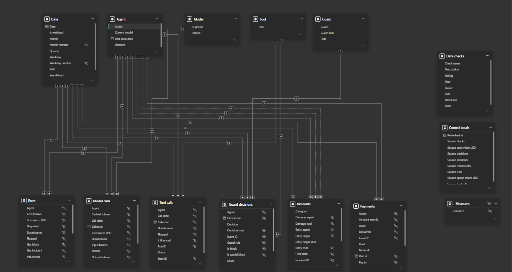

# Quard BI

A Power BI layer on top of Quard's Postgres data.

## What this is

## How to run

## Model



A star: 6 facts and 5 dimensions, in `powerbi/Quard.SemanticModel`.

- Facts: Runs, Model calls, Tool calls, Guard decisions, Incidents, Payments.
- Dimensions: Date, Agent, Model, Tool, Guard. Each one filters its facts, one to many, in one direction.
- No relationships between facts. Data checks and Control totals stand alone.
- Agent plays three roles on Incidents. `Damage agent` is active; `Entry agent` and `Turning agent` are inactive, for USERELATIONSHIP in measures.
- Date is the marked date table. Month, Weekday and Year-Month sort by their number columns.
- Facts show only their categories. Ids, keys and raw numbers are hidden; measures show them.
- Implicit measures are off. Measures live in `_Measures`.
- Every table and visible column has a description, saved as a `///` line in its TMDL file.

## Pages

## Standards

### Report design

The Power BI theme is [design/quard-theme.json](design/quard-theme.json), made from the product's colors in [web/DESIGN.md](../web/DESIGN.md). The wireframes are in [design/wireframes](design/wireframes).

- One question per visual. Its title says what it shows and in what unit, such as "Model cost (USD)".
- At most 8 visuals per page, slicers and the KPI card included. Each visual sends its own query.
- A page's headline numbers go in one card visual at the top, not one card per number.
- Slicers sit in the same place on every page: date top middle, agent top right.
- A color means the same thing everywhere: green is allowed or passed, red is blocked or failed, amber is observe mode or a warning.
- Color is never the only signal: a status always has an icon or a word too.
- At most five series per chart. The sixth theme color is grey, for the rest or for unknown.
- Text contrast is at least 4.5:1. The theme's text colors reach 6.8:1 or more on a panel.
- Panels are #191919 with a 1 px #2b2b2b hairline and square corners. The theme draws them on every chart and table, so pages need no shapes or background image.
- Text is Segoe UI. The Power BI Service can't render Manrope, the product's font.

### Page grid

Pages are 1280 x 720 px: 12 columns of 88 px, 16 px gutters and 24 px margins, on an 8 px base. Set a visual's exact place in Format > General > Properties.

| Area | Columns | X | Y | Width | Height |
| --- | --- | --- | --- | --- | --- |
| Title | 1 to 6 | 24 | 24 | 608 | 64 |
| Date slicer | 7 to 9 | 648 | 24 | 296 | 64 |
| Agent slicer | 10 to 12 | 960 | 24 | 296 | 64 |
| KPI card | 1 to 12 | 24 | 104 | 1232 | 96 |
| Chart row 1 | 1 to 12 | 24 | 216 | 1232 | 232 |
| Chart row 2 | 1 to 12 | 24 | 464 | 1232 | 232 |

A panel n columns wide is n x 104 - 16 px: 192, 296, 400, 608, 816 or 1232. Column n starts at x = 24 + (n - 1) x 104. The KPI card puts 16 px between its tiles, so 2, 3, 4 or 6 numbers line up with the columns; 5 don't.

### Naming

- SQL: `bi.dim_*`, `bi.fact_*` and `bi.dq_*`, in snake_case. Suffixes `_micro_usd`, `_ms`, `_date` and `_at`; prefixes `is_` and `has_`.
- Model: plural names for facts (Runs, Model calls), singular for dimensions (Agent, Date). Sentence case for columns and measures.
- Units go in measure names where they help, such as Latency p95 ms.
- Count measures end in "count", and control totals start with "Source", so a name never clashes with a table or a column.
- A KPI in [kpis.md](kpis.md) and its measure share one name.

### Best Practice Analyzer

[powerbi/bpa-rules.json](powerbi/bpa-rules.json) holds Microsoft's published rules and the `[Quard]` team rules. Severity 3 is an error and fails the `model` job in CI. A rule becomes an error only once the model passes it.

Run it before each commit that touches the model. It needs [Tabular Editor 2](https://github.com/TabularEditor/TabularEditor/releases) in `C:\tools\TabularEditor`:

```powershell
$te = Start-Process -FilePath "C:\tools\TabularEditor\TabularEditor.exe" -Wait -PassThru -NoNewWindow `
    -ArgumentList '"bi\powerbi\Quard.SemanticModel\definition" -A "bi\powerbi\bpa-rules.json"'
$te.ExitCode
```

## Data checks

Each check is one row of `bi.dq_checks` ([sql/30_checks.sql](sql/30_checks.sql)). The Data quality page shows the view, and pytest runs it. For each check, a test plants a defect and expects the check to fail ([tests/test_quality.py](tests/test_quality.py)).

- **Reconcile**: run totals against their steps and payments, and raw events against the tables built from them. Threshold 0.
- **Rule**: a block always opens an incident, and no incident stays pending. Threshold 0.
- **Monitor**: shares that may be above 0, each with its own threshold.

`bi.control_totals` counts runs, calls, decisions, blocks, incidents, cost and spend straight from the app tables. The report compares its own totals with these.

To run the checks on the demo data:

```sh
uv run --directory bi pytest -m live --no-cov -s
```

On the demo data every reconcile and rule check passes. The control totals match the bi views: 8,361,559 micro-dollars of model cost, 43,520,000 of spend and 4,074 enforced blocks.

| Monitor | Failing | Total | Rate | Threshold |
| --- | --- | --- | --- | --- |
| Cost unknown | 284 | 14,289 | 2.0% | 5% |
| Spend unknown | 0 | 1,629 | 0% | 5% |
| Paid, not delivered | 267 | 4,352 | 6.1% | 2% |
| Late events | 0 | 334,861 | 0% | 1% |
| Dropped events | 0 | 334,861 | 0% | 0.1% |

Paid, not delivered fails on purpose: the "Paid API fails after payment" scenario settles a payment and then answers 500.

## Performance

## Findings

### Back-dating

The generator made all 14,289 runs in 22 minutes on one day. [seed/backdate.sql](seed/backdate.sql) spreads them over the last 6 months:

| Month | Runs |
| --- | --- |
| April 2026 | 2 |
| May 2026 | 489 |
| June 2026 | 1,308 |
| July 2026 | 2,231 |
| August 2026 | 3,040 |
| September 2026 | 3,691 |
| October 2026 (to the 23rd) | 3,528 |

11% of runs fall on a weekend and 94% between 08:00 and 17:59 UTC. Every timestamp of a run moved by the same amount, so no event, step or incident falls outside its run.

On Windows, psycopg hangs on `localhost`: it tries `::1` first, and Docker publishes the port on `127.0.0.1` only. The database URLs in `.env.example` use `127.0.0.1`.

### Star schema

The [sql](sql) folder builds the `bi` views. On the demo data each fact has exactly as many rows as its source table, and every fact key is in its dimension.

| Fact | Rows |
| --- | --- |
| Runs | 14,289 |
| Model calls | 45,836 |
| Tool calls | 33,712 |
| Decisions | 137,796 |
| Incidents | 4,093 |
| Payments | 13,602 |

The dimensions are small: 5 agents, 5 models, 10 tools and 16 guard rules. `acme-ft-1` is the one model with no price.

273 incidents have no verdict yet, so their category is `unknown` and they have no entry origin.

Power BI signs in as `bi_reader`, which can read the `bi` views and nothing in `public`.

### Reconciliation

- **50 runs more than the tally.** The seed tally counts 14,239 runs; the database has 14,289. The 50 extra runs came from outside the main seed run. They explain the small gaps between the tally and the checks, such as 267 undelivered payments against the tally's 266.
- **273 incidents without a verdict.** They are the "Paid link found in a web page" runs. The worker failed to find the damaging call, with "The damaging call's events never arrived": the guard refused the payment before it was signed, so there was no paid call to find.
- **412 tool calls stored as `ok` but blocked.** In the "Phishing link in an email" runs, the SDK sends the `readEmail` call twice: `ok` when the tool returns, then `blocked` when the signature blocks its content. Ingest keeps the first row it stores (`ON CONFLICT DO NOTHING`), so the step stays `ok` and the run's `blocked` count leaves it out. The block decision and the incident are there, so `block_has_incident` passes. The events-vs-steps check matches on the step id, not the status, so it does not see this.

### Power Query

The report imports the `bi` views in Import mode as `bi_reader`. It has 13 tables, 3 parameters (`PgServer`, `PgDatabase`, `ProjectId`) and 2 helper functions (`GetView`, `ColumnName`). Every table row count in Power BI matches the SQL count, such as 14,289 runs and 45,836 model calls, and a full refresh has no errors.

- **Where things are saved.** The parameters and helpers are in `definition/expressions.tmdl`, and each table's M code is in its own file under `definition/tables`. The sign-in is not in any saved file.
- **Folding was checked on a test query.** View Native Query is greyed out on a query that calls `GetView`. A test query with the same steps written out showed the project filter as a SQL `WHERE`, so Postgres does the filtering.
- **Auto date/time made 14 hidden tables.** Power BI builds a `LocalDateTable_*` table and a relationship for each date column. They are saved in Git for now, and B11 turns the option off and measures the difference.
- **No real relationships yet.** The only relationships in `relationships.tmdl` link date columns to those hidden tables. B8 adds the star schema.
- **The Date table has 246 days.** It runs from 30 April, the first run's day, to 31 December 2026. The end date follows the current year, so it grows at the next refresh after New Year.
- **Table names must match exactly.** DAX in B9 writes names like `'Model calls'`, so a capital in the wrong place breaks a measure. The names are `Guard decisions`, `Model calls`, `Tool calls`, `Data checks` and `Control totals`.

## Next
