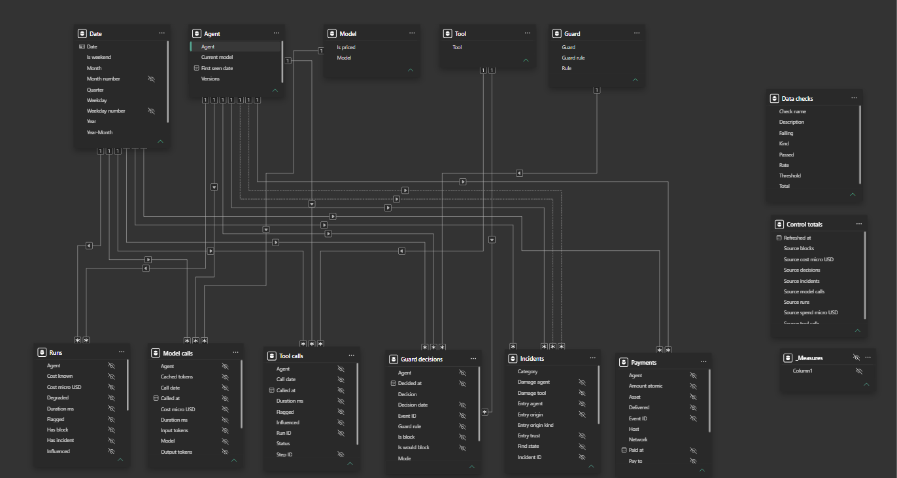
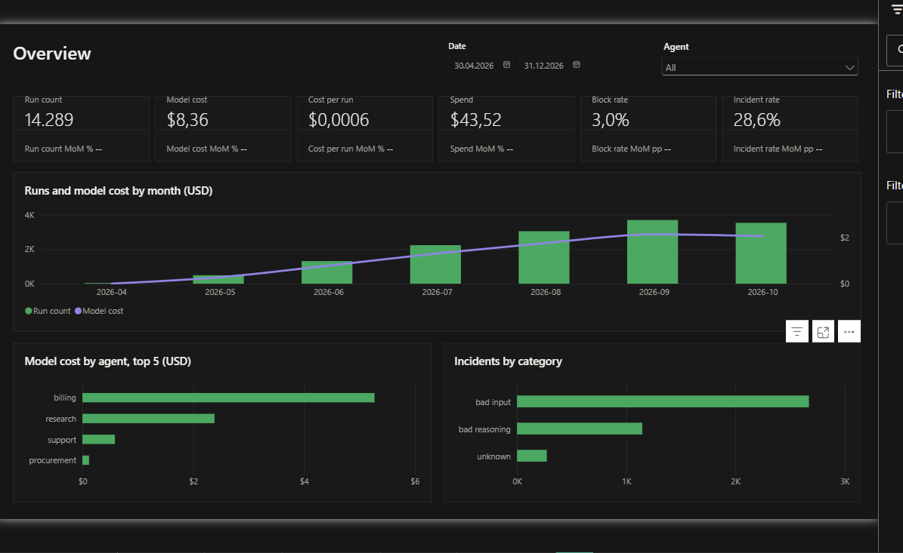
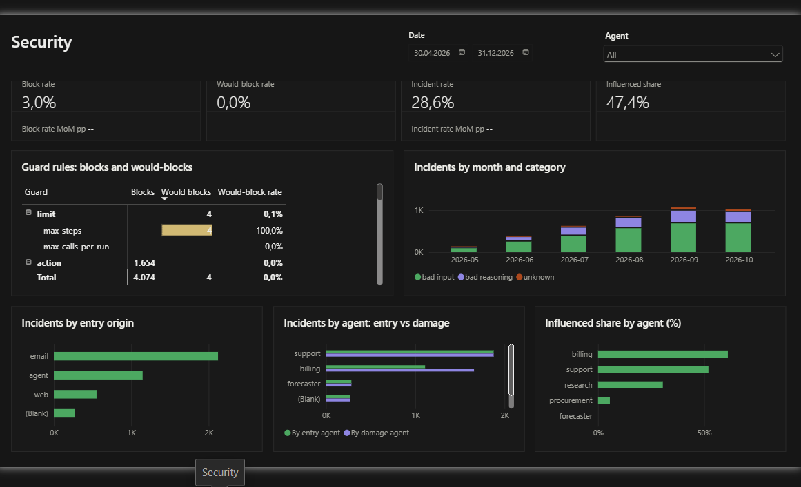
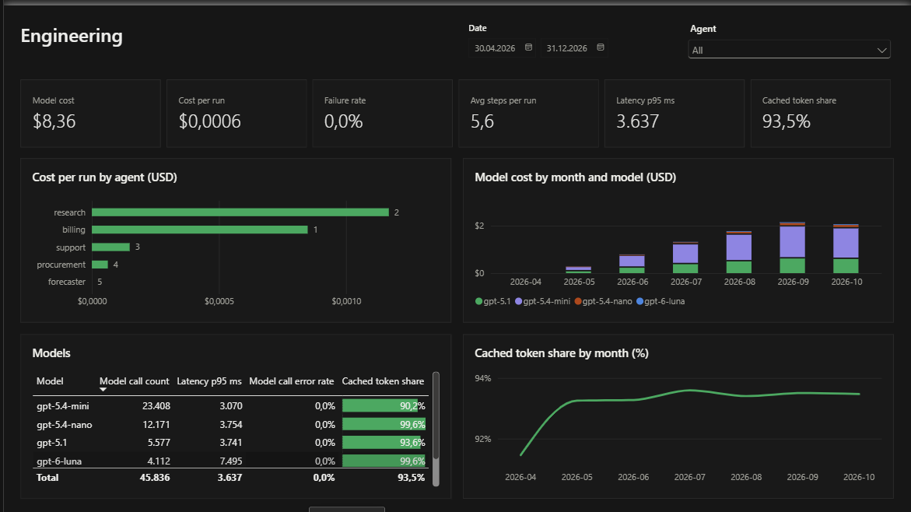
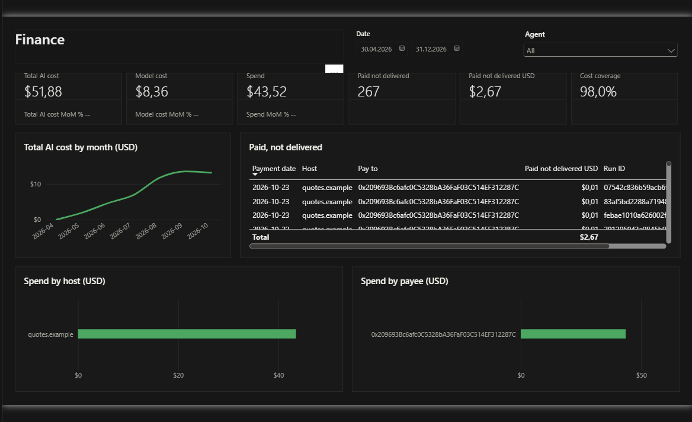
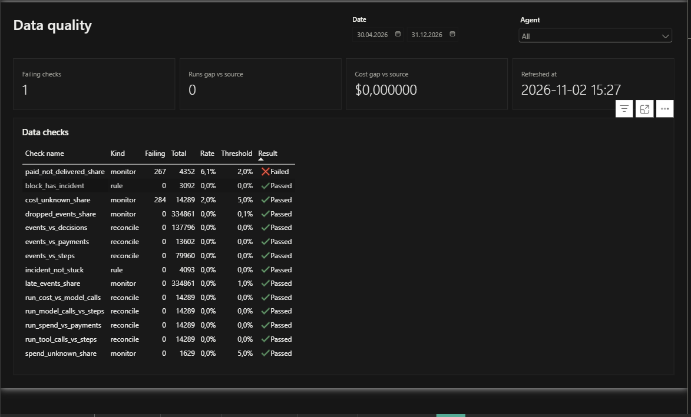

# Quard BI

A Power BI layer on top of Quard's Postgres data.

## What this is

Quard guards AI agents: it records every model call, tool call and payment an agent makes, blocks the dangerous ones, and opens an incident when something gets through. This folder turns that data into a Power BI report for four people: a security lead, an engineering manager, finance, and the platform operator who checks the data. Each has user stories and KPIs in [kpis.md](kpis.md), and each has a page. The data is not made up row by row: 14,289 agent runs went through the real SDK, webhook and worker, with Qwen3-8B on a rented GPU answering as the models, and SQL then spread them over six months. The report can be checked without opening it: every total is reconciled against the database, and the model and report files are text in Git, checked in CI.

The [PDF export](img/quard-bi.pdf) shows every page.

## How it flows

```text
Agents (SDK) -> webhook -> Postgres (app tables)
                              |
                         bi views (sql/*.sql): star schema, data checks, control totals
                              |
                         Power Query: imports the views as bi_reader, one project
                              |
                         semantic model (TMDL): relationships, 39 measures
                              |
                         report (PBIR): five pages
```

- **SQL** builds a star schema as views in a `bi` schema ([sql](sql)). The app never depends on them, so they can change freely.
- **Power Query** imports the views in Import mode, filtered to one project, and folds that filter into SQL.
- **The model** links 5 dimensions to 6 facts and holds every KPI as a measure.
- **CI** ([bi.yml](../.github/workflows/bi.yml)) runs on every push: pytest builds the views in a fresh database and plants a defect for each data check; the Best Practice Analyzer checks the model; the report tests check every page against the standards below.

## How to run

You need Docker, Node 24 with pnpm, [uv](https://docs.astral.sh/uv/), and Power BI Desktop on Windows.

1. Start Postgres on port 5433 and apply the app's migrations:

    ```sh
    cp bi/.env.example bi/.env    # then set BI_READER_PASSWORD
    docker compose -f bi/compose.yaml up -d
    node --env-file=bi/.env db/main.ts
    uv sync --directory bi
    ```

2. Load demo data. Either restore a dump made by the generator ([sandbox/seed](../sandbox/seed)), which is too big for Git:

    ```sh
    docker compose -f bi/compose.yaml cp bi/data/quard-demo.dump postgres:/tmp/quard-demo.dump
    docker compose -f bi/compose.yaml exec postgres sh -c 'psql -U quard -d postgres -c "DROP DATABASE quard WITH (FORCE)" && psql -U quard -d postgres -c "CREATE DATABASE quard OWNER quard" && pg_restore -U quard -d quard --no-owner /tmp/quard-demo.dump'
    ```

    Or make new runs. The generator needs a Chat Completions server for Qwen3-8B on port 30000 (sglang on a GPU), and the webhook, control and worker running with `bi/.env`:

    ```sh
    node --env-file=bi/.env db/cli/setup-main.ts --project "Acme demo"   # prints the agent key for bi/.env
    node --env-file=bi/.env sandbox/seed/main.ts --runs 3000 --concurrency 32
    uv run --directory bi python apply.py seed/backdate.sql             # spreads the runs over six months
    ```

3. Build the `bi` views and the `bi_reader` role:

    ```sh
    uv run --directory bi python apply.py
    ```

4. Open `powerbi/Quard.pbip` in Power BI Desktop. In Home > Transform data > Edit parameters, set `ProjectId` to your project's id. Sign in to the database as `bi_reader` with the password from `bi/.env`, then Refresh.

5. Run the checks:

    ```sh
    uv run --directory bi pytest                       # SQL, data checks and report tests
    uv run --directory bi pytest -m live --no-cov -s   # data checks on the demo data
    uv run --directory bi python perf/summary.py       # the performance table
    ```

    The Best Practice Analyzer command is under Standards.

## Model



A star: 6 facts and 5 dimensions, in `powerbi/Quard.SemanticModel`.

- Facts: Runs, Model calls, Tool calls, Guard decisions, Incidents, Payments.
- Dimensions: Date, Agent, Model, Tool, Guard. Each one filters its facts, one to many, in one direction.
- No relationships between facts. Data checks and Control totals stand alone.
- Agent plays three roles on Incidents. `Damage agent` is active; `Entry agent` and `Turning agent` are inactive, for USERELATIONSHIP in measures.
- Date is the marked date table. Month, Weekday and Year-Month sort by their number columns.
- Facts import only the columns a visual, measure or relationship uses; the bi views keep the rest. Facts show only their categories. Keys and raw numbers are hidden; measures show them. Payments shows Run ID and Pay to, for the Finance page's list of payments to dispute.
- Implicit measures are off. Measures live in `_Measures`.
- Every table and visible column has a description, saved as a `///` line in its TMDL file.
- Each KPI in [kpis.md](kpis.md) is a measure with the same name, its definition as the description, a format string and a display folder.
- Rates add `+ 0` to the top number: 0% when there is data, blank when there is none. Counts stay blank, so empty rows stay out of tables.
- Month-over-month measures are blank unless the date filter is inside one month and that month has a value.
- Two DAX queries are saved in the model: `Totals` and `By month`. Run them after every model change.

## Pages

Every page starts with the same header: its title, a date range slicer, an agent slicer and one KPI card. The slicers are synced across pages, except that they don't filter the Data quality page. `tests/test_report.py` checks the grid, alt text, titles, tab order, slicer sync, the theme copy, and that every field a visual uses exists in the model.

Finance differs from its wireframe: the paid-not-delivered table is 8 columns wide and the cost line 4, because payee addresses and run ids are long. Power BI shows true/false columns as True or False whatever their format string, so the Data checks table shows a `Check result` measure instead of the Passed column.

| Page | Stories | Shows |
| --- | --- | --- |
| [Overview](img/overview.png) | ALL-1 | Headline KPIs with their MoM change, runs and cost by month, top 5 agents by cost, incidents by category. |
| [Security](img/security.png) | SEC-1 to SEC-3 | Guard rules with blocks and would-blocks, incidents by month, origin and agent, influenced share by agent. |
| [Engineering](img/engineering.png) | ENG-1 to ENG-3 | Cost per run by agent with its rank, model cost by model, a models table, cached token share by month. |
| [Finance](img/finance.png) | FIN-1 to FIN-3 | Total AI cost by month, paid-not-delivered payments, spend by host and by payee. |
| [Data quality](img/data-quality.png) | OPS-1, OPS-2 | Every data check with a passed or failed icon and word. |

### Overview



### Security



### Engineering



### Finance



### Data quality



## Standards

### Report design

The Power BI theme is [design/quard-theme.json](design/quard-theme.json), made from the product's colors in [web/DESIGN.md](../web/DESIGN.md). The wireframes are in [design/wireframes](design/wireframes).

- One question per visual. Its title says what it shows and in what unit, such as "Model cost (USD)".
- At most 8 visuals per page, slicers and the KPI card included. Each visual sends its own query.
- A page's headline numbers go in one card visual at the top, not one card per number.
- Slicers sit in the same place on every page: date top middle, agent top right.
- A color means the same thing everywhere: green is allowed or passed, red is blocked or failed, amber is observe mode or a warning.
- Color is never the only signal: a status always has an icon or a word too.
- At most five series per chart. The sixth theme color is grey, for the rest or for unknown.
- Text contrast is at least 4.5:1. The theme's text colors reach 6.8:1 or more on a panel.
- Panels are #191919 with a 1 px #2b2b2b hairline and square corners. The theme draws them on every chart and table, so pages need no shapes or background image.
- Text is Segoe UI. The Power BI Service can't render Manrope, the product's font.

### Page grid

Pages are 1280 x 720 px: 12 columns of 88 px, 16 px gutters and 24 px margins, on an 8 px base. Set a visual's exact place in Format > General > Properties.

| Area | Columns | X | Y | Width | Height |
| --- | --- | --- | --- | --- | --- |
| Title | 1 to 6 | 24 | 24 | 608 | 64 |
| Date slicer | 7 to 9 | 648 | 24 | 296 | 64 |
| Agent slicer | 10 to 12 | 960 | 24 | 296 | 64 |
| KPI card | 1 to 12 | 24 | 104 | 1232 | 96 |
| Chart row 1 | 1 to 12 | 24 | 216 | 1232 | 232 |
| Chart row 2 | 1 to 12 | 24 | 464 | 1232 | 232 |

A panel n columns wide is n x 104 - 16 px: 192, 296, 400, 608, 816 or 1232. Column n starts at x = 24 + (n - 1) x 104. The KPI card puts 16 px between its tiles, so 2, 3, 4 or 6 numbers line up with the columns; 5 don't.

### Naming

- SQL: `bi.dim_*`, `bi.fact_*` and `bi.dq_*`, in snake_case. Suffixes `_micro_usd`, `_ms`, `_date` and `_at`; prefixes `is_` and `has_`.
- Model: plural names for facts (Runs, Model calls), singular for dimensions (Agent, Date). Sentence case for columns and measures.
- Units go in measure names where they help, such as Latency p95 ms.
- Count measures end in "count", and control totals start with "Source", so a name never clashes with a table or a column.
- A KPI in [kpis.md](kpis.md) and its measure share one name.

### Best Practice Analyzer

[powerbi/bpa-rules.json](powerbi/bpa-rules.json) holds Microsoft's published rules and the `[Quard]` team rules. Severity 3 is an error and fails the `model` job in CI. A rule becomes an error only once the model passes it.

Run it before each commit that touches the model. It needs [Tabular Editor 2](https://github.com/TabularEditor/TabularEditor/releases) in `C:\tools\TabularEditor`:

```powershell
$te = Start-Process -FilePath "C:\tools\TabularEditor\TabularEditor.exe" -Wait -PassThru -NoNewWindow `
    -ArgumentList '"bi\powerbi\Quard.SemanticModel\definition" -A "bi\powerbi\bpa-rules.json"'
$te.ExitCode
```

## Data checks

Each check is one row of `bi.dq_checks` ([sql/30_checks.sql](sql/30_checks.sql)). The Data quality page shows the view, and pytest runs it. For each check, a test plants a defect and expects the check to fail ([tests/test_quality.py](tests/test_quality.py)).

- **Reconcile**: run totals against their steps and payments, and raw events against the tables built from them. Threshold 0.
- **Rule**: a block always opens an incident, and no incident stays pending. Threshold 0.
- **Monitor**: shares that may be above 0, each with its own threshold.

`bi.control_totals` counts runs, calls, decisions, blocks, incidents, cost and spend straight from the app tables. The report compares its own totals with these.

To run the checks on the demo data:

```sh
uv run --directory bi pytest -m live --no-cov -s
```

On the demo data every reconcile and rule check passes. The control totals match the bi views: 8,361,559 micro-dollars of model cost, 43,520,000 of spend and 4,074 enforced blocks.

| Monitor | Failing | Total | Rate | Threshold |
| --- | --- | --- | --- | --- |
| Cost unknown | 284 | 14,289 | 2.0% | 5% |
| Spend unknown | 0 | 1,629 | 0% | 5% |
| Paid, not delivered | 267 | 4,352 | 6.1% | 2% |
| Late events | 0 | 334,861 | 0% | 1% |
| Dropped events | 0 | 334,861 | 0% | 0.1% |

Paid, not delivered fails on purpose: the "Paid API fails after payment" scenario settles a payment and then answers 500.

## Performance

Measured on the 14,289 demo runs, before and after the fixes. The exports are in [perf/before](perf/before) and [perf/after](perf/after), and [perf/summary.py](perf/summary.py) turns them into this table:

```sh
uv run --directory bi python perf/summary.py
```

| Metric | Before | After | Change |
| --- | --- | --- | --- |
| Model size (MB) | 82.0 | 37.9 | -54% |
| Hidden auto date tables | 8 | 0 | -100% |
| Largest column (MB) | 10.0 (Guard decisions[Event ID]) | 1.1 (Payments[Run ID]) | -89% |
| Full refresh (s) | 3.43 | 2.11 | -38% |
| Overview: DAX query total (ms) | 45 | 42 | -7% |
| Overview: slowest visual (ms) | 138 (Card) | 130 (Card) | -6% |
| Security: DAX query total (ms) | 72 | 62 | -14% |
| Security: slowest visual (ms) | 199 (Guard rules: blocks and would-blocks) | 175 (Guard rules: blocks and would-blocks) | -12% |
| Engineering: DAX query total (ms) | 77 | 80 | +4% |
| Engineering: slowest visual (ms) | 183 (Models) | 182 (Models) | -1% |
| Finance: DAX query total (ms) | 49 | 59 | +20% |
| Finance: slowest visual (ms) | 175 (Card) | 182 (Paid, not delivered) | +4% |
| Data quality: DAX query total (ms) | 23 | 18 | -22% |
| Data quality: slowest visual (ms) | 149 (Data checks) | 99 (Data checks) | -34% |

How it was measured:

- **Visuals:** Performance Analyzer, 3 refreshes of each page, the median for each visual. "DAX query total" adds up the visuals' DAX query times; "slowest visual" is the largest total time.
- **Model:** VertiPaq Analyzer statistics, exported with DAX Studio's `dscmd vpax`. They hold sizes, not data rows.
- **Refresh:** three full refreshes through the Tabular Object Model, timed in code, after one warm-up refresh. The first refresh after opening Power BI takes 13 to 17 s while Postgres and Power Query start up.

The fixes:

1. **Auto date/time off: 82.0 to 81.3 MB.** It built a hidden date table and relationship for each date column. The marked Date table already does that job, so they were dead weight, and the cause of most BPA warnings.
2. **Only the columns the report uses: 81.3 to 37.9 MB, refresh 3.43 to 2.11 s.** Each fact query now ends in `Table.SelectColumns`, which folds into the SQL `SELECT`, so Postgres sends less and Power BI compresses less. 34 hidden columns went: ids, full timestamps and unused flags. Ids and timestamps are nearly unique per row, so they compress badly: Guard decisions[Event ID] alone was 10 MB. BPA's "Remove unnecessary columns" rule listed the same columns. The `Totals` query still matches `bi.control_totals`.
3. **Dates as Date:** already done in B7. Only the timestamps were date and time, and fix 2 removed them.
4. **Calculated columns:** the only ones were in the auto date tables, so fix 1 removed them.
5. **Single direction:** all 18 relationships already were.
6. **Slowest query, kept as it is.** The Models table on Engineering has the slowest DAX query. DAX Studio's Server Timings showed 17 ms, all in the formula engine, with 3 storage engine queries. `Latency p95 ms` uses `PERCENTILE.INC`, which sorts every call's duration; the storage engine can only add and count, so that work can't move down. The other measures already filter single columns and use plain sums. Computing p95 in SQL would stop it reacting to the slicers, which isn't worth it for 17 ms.
7. **Fewer visuals: not done.** Each page has at most 8 visuals and a title, and each visual answers a user story.

What the numbers say:

- **The model got smaller, and the visuals stayed about the same.** DAX queries take 5 to 30 ms each; most of a visual's time is drawing it. On a model this small, the visual changes of up to ±20% are noise between runs.
- **Text columns cost at least 1 MB each.** VertiPaq gives every text column a dictionary of about 1 MB, even with 5 values. Dictionaries are 37.5 of the 37.9 MB left, across 39 text columns. Most are the text keys Agent, Tool, Model and Guard rule. Whole-number keys would shrink the model further: see Next.
- **Money as whole micro-dollars helps here too** (Key decision 10). Whole numbers compress better than decimals, and every cost column stays a 64-bit integer.

## Findings

What the demo data says. The scenario mix in the generator decides how often each attack happens, so the shares below describe this demo, not real traffic. The patterns, and the way the report finds them, carry over.

1. **Email is the main way in.** 2,121 of 4,093 incidents (52%) started with content from an email, 552 (13%) from a web page, and 1,147 (28%) from another agent's handoff. Why it matters: the security lead gets the most from stricter handling of email content, such as a lower trust level for the email tool. Caveat: 273 incidents (7%) have no known origin yet, because the worker could not find the damaging call (see Reconciliation).

2. **The support agent has an incident in almost half its runs.** 47.6% of its 3,945 runs, against 14 to 24% for billing, research and procurement. 1,466 of its incidents came in by email. Why it matters: support reads customer email all day, so it is the first agent to get fewer tools or stricter guards. Caveat: the forecaster has an incident in all 284 of its runs, but it only appears in the "paid link in a web page" attack scenario.

3. **One agent and one model make most of the cost.** Billing runs on gpt-5.4-mini and makes 63% of the model cost ($5.27 of $8.36), with 41% of the runs. Research costs the most per run: $0.00117, 8 times support. Why it matters: the engineering manager should look at billing's prompts or model first. Caveat: Qwen3-8B answered every call, so costs use each label's price list, not real bills; caching is high (90 to 99.6% of input tokens) because the prompts repeat.

4. **$2.67 paid for nothing.** 267 of 4,352 settled payments (6.1%) got no answer back, all to `quotes.example`, above the 2% threshold. Why it matters: finance has a ready list of payments to dispute, with run ids, on the Finance page. Caveat: the "Paid API fails after payment" scenario plants these on purpose.

5. **2% of runs have no cost.** All 284 are the forecaster's, on `acme-ft-1`, a fine-tuned model with no price. Cost coverage is 98.0%, under the 5% unknown threshold, but the forecaster's cost is invisible. Why it matters: finance asks engineering to add a price, and the Cost coverage tooltip says why the number is incomplete. Caveat: one unpriced model in a demo; a real fleet would have more.

## Build notes

What came up while building each layer.

### Back-dating

The generator made all 14,289 runs in 22 minutes on one day. [seed/backdate.sql](seed/backdate.sql) spreads them over the last 6 months:

| Month | Runs |
| --- | --- |
| April 2026 | 2 |
| May 2026 | 489 |
| June 2026 | 1,308 |
| July 2026 | 2,231 |
| August 2026 | 3,040 |
| September 2026 | 3,691 |
| October 2026 (to the 23rd) | 3,528 |

11% of runs fall on a weekend and 94% between 08:00 and 17:59 UTC. Every timestamp of a run moved by the same amount, so no event, step or incident falls outside its run.

On Windows, psycopg hangs on `localhost`: it tries `::1` first, and Docker publishes the port on `127.0.0.1` only. The database URLs in `.env.example` use `127.0.0.1`.

### Star schema

The [sql](sql) folder builds the `bi` views. On the demo data each fact has exactly as many rows as its source table, and every fact key is in its dimension.

| Fact | Rows |
| --- | --- |
| Runs | 14,289 |
| Model calls | 45,836 |
| Tool calls | 33,712 |
| Decisions | 137,796 |
| Incidents | 4,093 |
| Payments | 13,602 |

The dimensions are small: 5 agents, 5 models, 10 tools and 16 guard rules. `acme-ft-1` is the one model with no price.

273 incidents have no verdict yet, so their category is `unknown` and they have no entry origin.

Power BI signs in as `bi_reader`, which can read the `bi` views and nothing in `public`.

### Reconciliation

- **50 runs more than the tally.** The seed tally counts 14,239 runs; the database has 14,289. The 50 extra runs came from outside the main seed run. They explain the small gaps between the tally and the checks, such as 267 undelivered payments against the tally's 266.
- **273 incidents without a verdict.** They are the "Paid link found in a web page" runs. The worker failed to find the damaging call, with "The damaging call's events never arrived": the guard refused the payment before it was signed, so there was no paid call to find.
- **412 tool calls stored as `ok` but blocked.** In the "Phishing link in an email" runs, the SDK sends the `readEmail` call twice: `ok` when the tool returns, then `blocked` when the signature blocks its content. Ingest keeps the first row it stores (`ON CONFLICT DO NOTHING`), so the step stays `ok` and the run's `blocked` count leaves it out. The block decision and the incident are there, so `block_has_incident` passes. The events-vs-steps check matches on the step id, not the status, so it does not see this.

### Power Query

The report imports the `bi` views in Import mode as `bi_reader`. It has 13 tables, 3 parameters (`PgServer`, `PgDatabase`, `ProjectId`) and 2 helper functions (`GetView`, `ColumnName`). Every table row count in Power BI matches the SQL count, such as 14,289 runs and 45,836 model calls, and a full refresh has no errors.

- **Where things are saved.** The parameters and helpers are in `definition/expressions.tmdl`, and each table's M code is in its own file under `definition/tables`. The sign-in is not in any saved file.
- **Folding was checked on a test query.** View Native Query is greyed out on a query that calls `GetView`. A test query with the same steps written out showed the project filter as a SQL `WHERE`, so Postgres does the filtering.
- **Auto date/time made 14 hidden tables.** Power BI builds a `LocalDateTable_*` table and a relationship for each date column. B11 turned the option off: see Performance.
- **No real relationships yet.** The only relationships in `relationships.tmdl` link date columns to those hidden tables. B8 adds the star schema.
- **The Date table has 246 days.** It runs from 30 April, the first run's day, to 31 December 2026. The end date follows the current year, so it grows at the next refresh after New Year.
- **Table names must match exactly.** DAX in B9 writes names like `'Model calls'`, so a capital in the wrong place breaks a measure. The names are `Guard decisions`, `Model calls`, `Tool calls`, `Data checks` and `Control totals`.

### DAX measures

36 measures in 6 display folders. The `Totals` query matches `bi.control_totals`: 14,289 runs, 8,361,559 micro-dollars of model cost, 43,520,000 of spend, 4,074 blocks and 4,093 incidents. The `By month` query matches SQL for runs and model cost in every month.

- **Blank minus a number is a number.** November has no data, but Run count MoM % showed -100% and Block rate MoM pp -2.91. A MoM measure now checks that its own month has a value.
- **A zero rate was blank.** April has 15 decisions and 0 blocks. `[Blocks]` is blank there, and so was `DIVIDE ( [Blocks], [Decision count] )`, which left May's Block rate MoM pp blank. Rates now add `+ 0` to the top number.
- **May grows by 24,350%.** April holds 2 runs, both on 30 April, the first day of data. The math is right; the first month is almost empty.
- **BPA warns on 15 format strings.** Microsoft's rules want `#,0.0%;-#,0.0%;#,0.0%` for percentages. MoM measures keep a `+` sign, which a card needs to show growth, and a rate never reaches 1,000%, so they stay warnings. The rest are false alarms. Last refresh is a date, not a whole number. Check passed and Check result are hidden helpers for the Data checks table: they look unused because BPA can't see the report, and Check result is text, not a whole number.

## Next

- **Publish to the Power BI Service** with a gateway to the local database and a scheduled refresh, so people open a link instead of a file.
- **Deploy from Git:** Fabric's Git integration can update a workspace from `bi/powerbi` on `main`.
- **An alert** when the incident count jumps, with Power Automate on a pinned card.
- **Incremental refresh** on the facts, by date. A full refresh takes 2 s today, but it grows with every run.
- **Row-level security by team,** so each team sees only its own agents.
- **Whole-number keys.** Agent, Tool, Model and Guard rule join on text, and each text column costs about 1 MB. Integer keys in the bi views would shrink the model further.
- **An "Agent details" drill-through page,** and one calculation group in place of the month-over-month copies of each measure.
